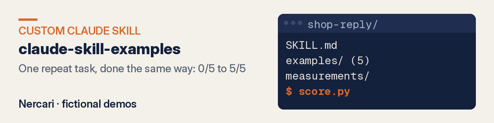
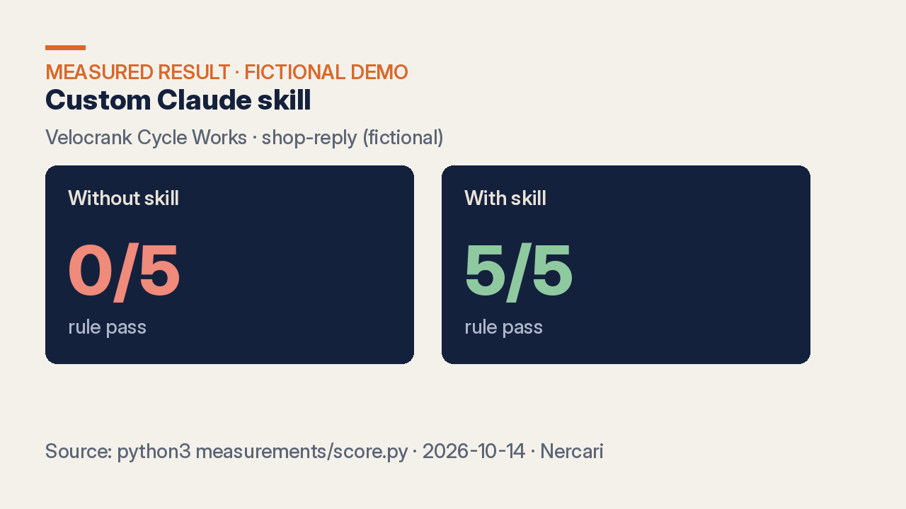

# Claude skill examples — measured, fictional demos by Nercari

**One repeat task, done the same way every time.** A custom Claude skill (a `SKILL.md` folder) took the same 5 inputs from **0/5 to 5/5** rule pass (`measurements/score.py`).

**[Hire this on Fiverr →](https://www.fiverr.com/nercari/PLACEHOLDER-claude-skill)** · **[See live demo](https://nercari.github.io/claude-skill-examples/)**

## What you get

- The skill folder: `SKILL.md` plus any helper files (see `SKILL.md`, `skills/meeting-notes/`)
- A deterministic checker for your rules (`measurements/score.py`)
- 5 test inputs with and without the skill, scored side by side (`measurements/with/`, `measurements/without/`, `measurements/results.json`)
- Package checks that run in CI (`check.py` → 5/5)
- Install steps

Packages: ONE SKILL / TESTED SKILL / SKILL PACK (see the Fiverr gig).

## What changed when the skill was on?

| Skill | Same 5 inputs, **without** skill | **With** skill | How to reproduce |
|---|---|---|---|
| `shop-reply` (Velocrank Cycle Works bike shop replies) | **0/5** pass | **5/5** pass | `bash measurements/run.sh && python3 measurements/score.py` |
| `skills/meeting-notes` (Quillmere Plumbing meeting summaries) | **0/5** pass | **5/5** pass | same commands against the meeting-notes fixtures |

**What "pass" means:** every rule in the skill's deterministic checker is met.
- shop-reply: correct sign-off, ≤150 words, Subject line only for email, ≤1 "!", no emoji, no corporate phrases, **no $ amount that isn't in the owner's notes**. Without the skill, all 5 failed on sign-off and 3 also on channel format (`measurements/score.py` output).
- meeting-notes: required sections present, no invented decisions, action owners only from the transcript.

Static package checks: `python3 check.py` → **5/5**.

## How it works

1. You send the repeat task, a few real examples and your rules.
2. The rules go into `SKILL.md`; each rule also gets a check in the scorer (`measurements/score.py`).
3. The same inputs run without and with the skill (`measurements/run.sh`), and the scores go in the delivery.
4. You copy the skill folder into your Claude skills directory and can re-run the checker on your own inputs.

## Live demo

[nercari.github.io/claude-skill-examples](https://nercari.github.io/claude-skill-examples/) — landing page for the Velocrank Cycle Works skill demo, with schema, sitemap, robots (AI crawlers allowed) and `llms.txt` (`docs/pages/`).

## What this is and isn't

- **Sample data, labelled.** Velocrank Cycle Works and Quillmere Plumbing are fictional and not client work (`SAMPLE-NOTES.md`). The `examples/*/output.md` files are **hand-written fixtures used by the checker**, not a live model run. The with/without scores come from the dated 2026-10-14 runs in `measurements/`.
- **Limits.** The numbers show the skill met its rules on these 5 fixtures. Your inputs and rules will differ, so your pass rate may too.
- **No guarantee.** No business result, ranking or AI citation is promised.
- **Secrets.** No API keys or customer data are in this repo. For your skill, send sample data with private details removed; nothing you send is published.

## FAQ

### Can the skill invent prices?
The shop-reply checker fails any dollar amount that is not in the owner's notes. On the with-skill runs, no invented price appeared (`measurements/results.json`).

### How do I install a skill?
Copy the skill folder into your Claude skills directory (see `SKILL.md`). Then run the checker on your own fixtures.

## Docs

- `SKILL.md` and `skills/` — the skills as delivered
- `examples/` — sample inputs and outputs
- `measurements/` — the 5 fixtures, with/without runs, and the scorer
- `check.py` — CI package checks
- `docs/pages/` — the GitHub Pages site
- `llms.txt` — machine-readable summary for AI crawlers

Other showcases: [Claude Code setup](https://github.com/Nercari/claude-code-setup-example) · [SEO/GEO/AEO audit](https://github.com/Nercari/seo-geo-aeo-audit-demo) · [Nercari profile](https://github.com/Nercari/Nercari)

Delivery-only through Fiverr. No video calls, voice or face content.
